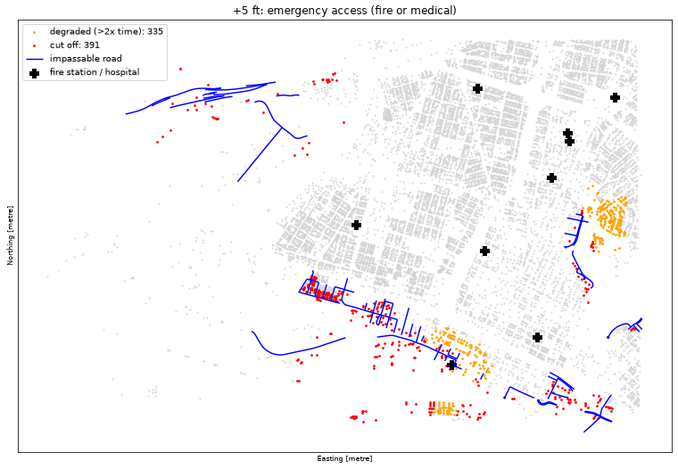

# West Oakland Flood Consequences: Findings Brief

*Input to Oakland's Subregional Shoreline Adaptation Plan community process (2026-2027). A
student-built exploration tool, **not an official hazard or evacuation assessment**. Defer to
ART, BCDC, and City of Oakland plans. Generated 2026-11-21 from `stats.json`.*

**Official flood maps show where water goes. This shows what it means for the people who live there, and where help should start.**

## Key findings

1. **Exposure concentrates on already-burdened communities.** At +3 ft and +4 ft, about
   96% and 94% of affected residents live in
   CalEnviroScreen top-quartile tracts, versus 28% of Oakland residents overall
   (3.4x over-represented at +4 ft).
2. **Emergency access fails before homes flood.** At +4 ft, 217 residents are cut off
   from fire or medical services and 235 more face at least doubled response times,
   largely because **Oakland Fire Station 2 (fire station)** floods. At +5 ft: 1,999 cut off.
3. **Contamination is close to the water.** 30 open or managed-in-place
   cleanup sites lie in or within 100 m of +4 ft flooding (62 at +5 ft), with
   4,020 residents nearby at +5 ft. *Proximity, not proof of exposure.*
4. **A hidden risk below the waterline.** At +4 ft, 422 more buildings sit below the
   water level but are protected by higher ground (ART "low-lying" areas). Groundwater rise
   and drainage failure, not modeled here, could make these the next to flood.

## Impacts by scenario

| Sea-level rise | Hazard | Buildings flooded | Residents affected | Facilities lost | Residents cut off | Residents degraded access | Contaminated sites near flooding | Impassable road km |
|---|---|---|---|---|---|---|---|---|
| +0 ft | ART | 0 | 0 | 0 | 0 | 0 | 0 | 0.0 |
| +1 ft | ART | 6 | 8 | 0 | 0 | 0 | 17 | 0.0 |
| +2 ft | ART | 14 | 8 | 0 | 0 | 0 | 17 | 0.0 |
| +3 ft | ART | 49 | 907 | 0 | 71 | 0 | 23 | 2.9 |
| +4 ft | ART | 117 | 1,341 | 1 | 217 | 235 | 30 | 4.7 |
| +5 ft | model* | 417 | 3,796 | 2 | 1,999 | 1,123 | 62 | 21.6 |

\* ART publishes no 60-inch layer, so +5 ft uses our LiDAR flood model (it matches NOAA's
5 ft map at 0.88 overlap). ART's own maps flood **620 buildings at +4.3 ft** and
**1,137 at +5.5 ft**, so treat +5 ft as a likely **underestimate**.

## Where help should start: top priority tracts (+4 ft)

| # | Tract | City | CalEnviroScreen pctl | Flooded bldgs | Residents affected | Residents cut off |
|---|---|---|---|---|---|---|
| 1 | 4033.02 | Oakland | 83 | 29 | 335 | 125 |
| 2 | 4287.00 | Alameda | 78 | 53 | 899 | 0 |
| 3 | 9832.00 | Oakland | 55 | 12 | 76 | 3 |
| 4 | 4017.00 | Oakland | 80 | 11 | 0 | 89 |
| 5 | 4060.00 | Oakland | 88 | 12 | 31 | 0 |

Priority = Exposure x Vulnerability. Exposure averages the share of buildings flooded, the
facilities lost, and the share of residents cut off (each scaled 0-1 across tracts).
Vulnerability is the CalEnviroScreen 4.0 percentile. Port/industrial tracts without a
CalEnviroScreen score are not ranked.

## Method (3 sentences)

Flood extents come from the ART Bay Shoreline Flood Explorer (BCDC) at 12-48 inches above
today's high tide, with depth estimated from 2021 USGS LiDAR. We intersected these with
13,600 buildings, the road network (routing to Oakland fire stations and CDPH-licensed
hospitals and clinics), and state cleanup-site databases. Residents are allocated from
2020 Census tracts to residential parcels and weighted by CalEnviroScreen 4.0.

## Limitations

- Exploration tool, not an official hazard or evacuation map. Still-water flooding only: no
  storm surge (a 100-year storm adds ~0.84 m), rainfall, groundwater rise, or compound events.
- Depth is estimated from LiDAR inside ART's extent. Residents per building are an
  area-based estimate. 97% of building heights are estimated. Roblox buildings are boxes.
- Drive times are free-flow estimates without traffic or dispatch time. Fire stations are
  Oakland's only (Alameda and Emeryville stations not included).
- Contaminated-site proximity does not mean residents are exposed.
